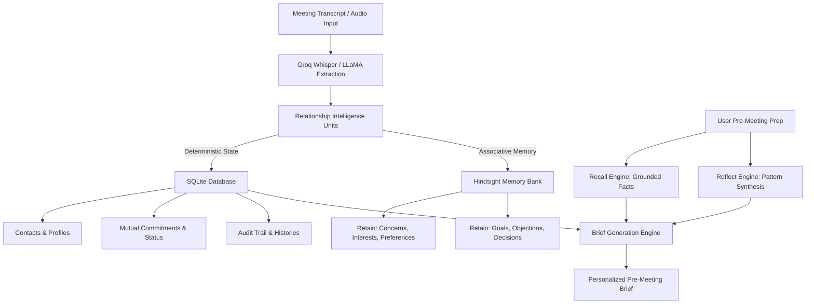

# RELATIO — Relationship Intelligence for Better Meetings

**Relatio** is a persistent memory agent that turns meeting transcripts and conversation notes into long-term relationship intelligence, mutual commitment tracking, and actionable pre-meeting briefs.

Traditional meeting assistants produce summaries of single meetings and treat every conversation as an isolated event. Relatio maintains long-term memory across weeks and months, detecting how stakeholder priorities shift, tracking commitments to completion, and preparing you for subsequent meetings with full historical context.

---

## Architecture

Relatio utilizes a dual-layer architecture separating deterministic application state from semantic memory:



* **SQLite**: Stores what happened (structured lifecycle state, contact records, commitments, meeting dates).
* **Hindsight**: Remembers what it means (evolving stakeholder concerns, communication preferences, behavioral patterns over time).

---

## Core Features

1. **Stakeholder CRM & Relationship Profiles**: Track individual contacts, organization roles, meeting frequency, and cumulative memory units.
2. **Discrete Intelligence Extraction**: Automatically categorizes conversation nuances into typed units:
   - `Preferences` & `Interests`
   - `Concerns` & `Objections`
   - `Goals` & `Requirements`
   - `Strategic Decisions`
   - `Mutual Commitments`
3. **Pre-Meeting Executive Briefs**: Synthesizes historical context, pending deliverables, and recommended talking points with grounded evidence citations.
4. **Natural Language Memory Q&A**: Ask questions about any contact across all past interactions (e.g. *"What are Rahul's infrastructure concerns?"*).
5. **Commitment Tracker & Accountability**: Track who committed to what, deadlines, and follow-through ratings to prevent promises from slipping.
6. **Relationship Evolution**: Synthesizes how priorities, trust, and topics have shifted longitudinally across meetings.
7. **Calendar Export (.ics)**: Automatically detects datable deadlines and exports confirmed `.ics` schedule events.

---

## Quickstart & Setup

### 1. Prerequisites
- Python 3.10+
- Groq API Key ([console.groq.com](https://console.groq.com))
- Hindsight API Key & Bank ([hindsight.vectorize.io](https://hindsight.vectorize.io))

### 2. Installation
```bash
git clone https://github.com/visualxswaroop/relatio-memory-agent.git
cd relatio-memory-agent
pip install -r requirements.txt
```

### 3. Environment Configuration
Create a `.env` file in the root directory (or copy from `.env.example`):
```ini
# Groq API Keys
GROQ_API_KEY_MAIN=gsk_your_groq_api_key

# Hindsight Cloud Configuration
HINDSIGHT_API_KEY=hsk_your_hindsight_api_key
HINDSIGHT_URL=https://api.hindsight.vectorize.io
BANK_ID=meeting-intelligence

# Model Config
MODEL_TRANSCRIBE=whisper-large-v3-turbo
MODEL_CORRECT=qwen/qwen3.8-27b
MODEL_EXTRACT=qwen/qwen3.8-27b
MODEL_SUMMARY=qwen/qwen3.8-27b
MODEL_BRIEF=qwen/qwen3.8-27b
```

### 4. Run the Application
```bash
python -m backend.app
```
Open your browser to `http://localhost:5000` to access the Relatio dashboard.

---

## Running the Test Suite

Verify Hindsight connectivity, extraction, memory recall, and relationship briefing:
```bash
python test_relationship_api.py
```

---

## Technical Deep-Dive

For a comprehensive technical walkthrough of the architecture, memory extraction design, and engineering tradeoffs, read [article.md](article.md).
